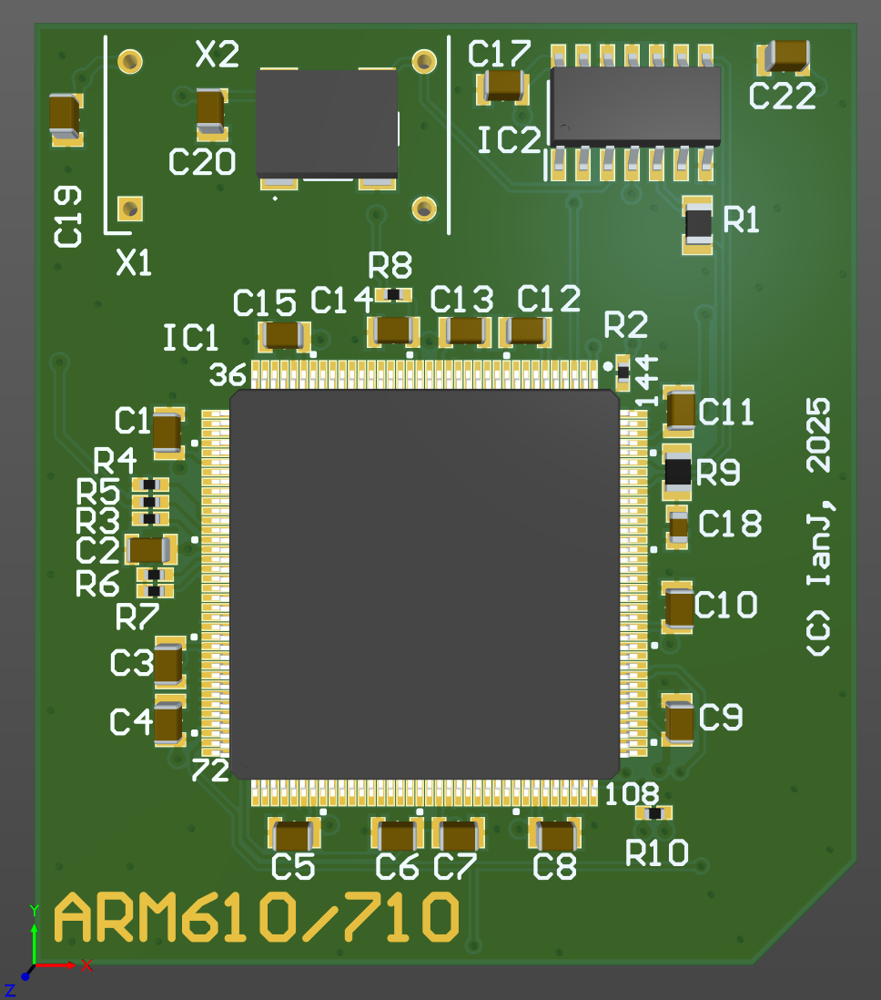

# Acorn Archimedes ARM6 (ARM610/ARM710) processor card

November 2026

An experimental platform adapting an ARM2 PLCC pinout to support an ARM610 or ARM710.

Built and tested in A3000, A310 and A540 (the latter with my 'ARM2' adapter).  An unmodified RISC OS 3.1 fails POST as expected (PPL error, because Arm610/710 has no TRANS pin so no external PPL possible) but if allowed to continue RISC OS does run and the desktop can be used and all RISC OS 3.1-era software tested so far has worked as expected.    A single-instruction-tweaked verison of RISC OS 3.11 has been produced to resolve this - just skipping the PPL test in POST.

There is still an open question about the 'VIDC SEQ bodge' on this card - this fix was originally found on the prototype Arm600 card and appeared to be necessary to make VIDC work, but now it seems it may be unnecessary.  There appears no adverse side-effect either way, and the bodge is easily undone by removing two ICs from the board and bridging two pins where they were, but greater understanding of this would be good.

It is essential to load Sarah Walker's amazing [Arm 6 support module](https://github.com/sarah-walker-pcem/ARM6Support) to enable the cache, buffering and memory protection - this should be done early in any !Boot sequence (nominally by loading the module as the first line of !Boot.Utils.!BootRun) - until that is done, even an Arm710 operates slower than an Arm2.

Performance is great; a standard-clocked 40MHz Arm710 outperforming even vastly overclocked 50MHz ARM3, and even a 30MHz Arm610 is ahead of a 35MHz ARM3.

## Licence

No warranty is provided, and this work is used at your own risk.  

Licenced as CC BY-SA 4.0

Copyright 2026 Ian Jeffray

